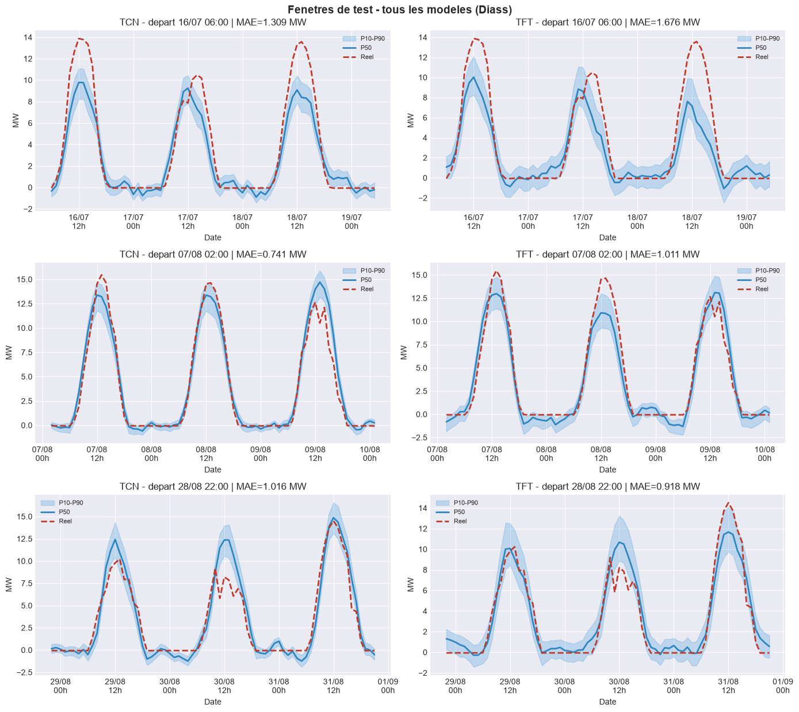

  
        
  

  Université Cheikh Anta Diop de Dakar · SENELEC

# Prévision probabiliste de la production photovoltaïque à 72 h par apprentissage profond (TCN, TFT) : application à la centrale de Diass, Sénégal

  Mémoire de Licence 3 Informatique (UCAD) · Stage SENELEC · Dakar, octobre 2026

|                                |                                                                            |
| ------------------------------ | -------------------------------------------------------------------------- |
| **Auteur**                     | Baye Mor Gaye ([bayemor.gaye@ucad.edu.sn](mailto:bayemor.gaye@ucad.edu.sn)) |
| **Encadrant (UCAD)**           | Dr Ndiouma Bame                                                            |
| **Maîtres de stage (SENELEC)** | Dr Saidou Abdoul Soumare, Dr Abdoulaye Ba                                   |

Entre 2022 et 2025, l'énergie injectée sur le réseau interconnecté sénégalais passe de 5 895 à 7 486 GWh, et l'ambition nationale (Plan Sénégal Émergent) vise 40 % d'énergies renouvelables à l'horizon 2030. Avec 292 MWc de solaire déjà connectés et une première centrale solaire publique à Diass, le verrou n'est plus le déploiement des infrastructures mais la **prévision fiable de la production** : au Sahel, l'intermittence (passages nuageux, harmattan de novembre à février, hivernage de juillet à septembre) fait de chaque erreur de prévision un déséquilibre de réseau et une réserve thermique mobilisée en urgence.

Le mémoire propose une réponse méthodologique et opérationnelle : un cadre d'apprentissage profond pour la prévision de court terme à 72 h, avec une gestion explicite de l'incertitude par prévision par quantiles.

- Le mémoire en ligne : [site du mémoire](https://gayensis09.github.io/deep-aero-sn/) · [PDF du mémoire](./web/public/main.pdf)
- Le travail de bout en bout : [diass.ipynb](./diass.ipynb)

## La question de départ

> Comment concevoir un modèle d'apprentissage profond capable de prédire, avec précision et robustesse, la production électrique solaire à court terme à 72 h dans le contexte climatique sénégalais, tout en intégrant et en quantifiant l'incertitude inhérente à cette source renouvelable intermittente ?

## Objectifs et contributions

Trois contributions, de l'analyse physique jusqu'à la validation opérationnelle :

1. **Caractériser la variabilité physique** de la production photovoltaïque au Sénégal (cycles astronomiques, facteurs stochastiques liés aux nuages, aérosols de l'harmattan, température, soiling) et la structurer dans un **référentiel unifié des variables** pour la centrale de Diass (chapitre 2, sections 2.3 et 2.4). Sur le plan méthodologique, les **covariables futures issues des modèles de prévision numérique du temps (NWP)** sont intégrées à l'ensemble des pipelines d'entraînement, d'évaluation et de test, avec une sélection des variables par **approche d'union finale**.
2. **Évaluer comparativement les architectures d'apprentissage profond dédiées aux séries temporelles** : TCN à convolutions causales dilatées et Temporal Fusion Transformer (TFT) à attention interprétable, conçues pour la prévision multi-horizon à 72 h (stratégie MIMO), avec une sortie probabiliste par quantiles (q0,1 à q0,9) dont l'enveloppe est finement recalibrée par le CQR (*Conformal Quantile Regression*). Les fondations, les modèles de séries temporelles, les architectures avancées et la stratégie probabiliste sont traités aux chapitres 3 à 6.
3. **Valider rigoureusement le pipeline complet sur la centrale de Diass** (chapitre 7) : de l'exploration des données et du feature engineering causal (garantissant l'absence de fuite d'information) jusqu'à l'évaluation face aux modèles de référence et aux valeurs publiées du site.

## Résultats

Cinq modèles entraînés sur Diass avec un horizon de prévision de 72 h. Protocole : 1 049 fenêtres de test (du 16 juillet au 28 août 2026), 168 h d'historique pour 72 h de prévision.

| Modèle                  | RMSE (MW) | MAE (MW) | R²     |
| ----------------------- | --------- | -------- | ------ |
| Persistance (référence) | 6,905     | 4,987    | −1,013 |
| MLP                     | 2,323     | 1,275    | 0,772  |
| LSTM                    | 2,043     | 1,148    | 0,824  |
| **TCN**                 | **1,707** | **0,989** | **0,877** |
| TFT                     | 1,818     | 1,157    | 0,861  |

La SENELEC juge acceptable une marge d'erreur de 5 MW pour le dispatch quotidien, soit 22 % de la capacité publiée de Diass (23,1 MW) : les deux architectures avancées la respectent largement. La MAPE, indéfinie près de zéro production, ne sert pas au classement (3 282,8 % pour la persistance) ; pour les séquences entièrement nocturnes, le pipeline bascule sur la sMAPE, bornée à 200 %. R² et RMSE, plus robustes, classent le TCN en tête.

TCN et TFT sortent des quantiles q10/q50/q90 entraînés par la **perte hybride multi-tâche** (MSE sur la médiane, pinball sur les quantiles, pondérés par `mse_weight`), puis recalés par CQR : couverture de 79,8 % pour le TCN (proche de la cible de 80 %) et 74,2 % pour le TFT, aucun croisement de quantiles, scores calculés horizon par horizon. Le TFT apporte en plus une sélection de variables lisible, précieuse côté opérateur.

Le gisement et le rendement calculés collent aux valeurs publiées sur Diass (contrôle selon la norme IEC 61724) : gisement reproduit à 0,5 % près, rendement final à 4,8 %, performance ratio (64,8 %) dans la bande publiée, énergie annualisée à +0,9 %. Les métriques d'une référence locale s'étant révélées mathématiquement impossibles (RMSE inférieure à sa MAE), elles ne sont pas retenues.

*Réel contre médiane P50 et enveloppe P10–P90 pour le TCN et le TFT, sur trois fenêtres de test (début, milieu, fin). Les deux modèles suivent le cycle diurne ; les plus gros écarts sont aux transitions jour/nuit.*

## Données et méthode

- **SCADA** : six classeurs Excel du système de supervision Schneider (du 30/08/2025 au 31/08/2026), ramenés sur une grille de 15 min : 35 196 lignes, 58 colonnes, puis rééchantillonnage horaire (8 800 lignes).
- **Réanalyses et météo** : NASA POWER en base, ERA5 en secours, CAMS pour les aérosols, DNI/DHI par Open-Meteo ; prévisions du modèle ECMWF IFS HRES (via l'API Open-Meteo) en covariables futures, avec une règle de causalité par disponibilité opérationnelle.
- **Feature engineering causal** : sept plugins déterministes (encodage du temps, météo commune, fréquence du réseau, physique solaire, météo solaire, grandeurs électriques historiques décalées de J-1, lags et statistiques glissantes) ; à l'instant t, seules les données antérieures ou contemporaines de t sont accessibles.
- **Garde anti-fuite** : toute feature dont la corrélation avec la cible dépasse 0,99 est écartée automatiquement, à l'exception des drivers physiques explicitement autorisés ; le modèle ne peut pas apprendre la formule de l'onduleur à la place de la météo.
- **Sélection** : 543 variables candidates, 424 retenues en union finale (run de référence du 6 octobre 2026) ; contrôle qualité automatique (Great Expectations) avant entraînement.

*Diass (Mbour, Thiès) : 85 248 modules polycristallins Jinko de 320 W (27,28 MWc installés, 23,114 MW publiés, écart documenté), 36 onduleurs Schneider Conext Core XC-680, environ 40 ha. Première centrale solaire publique du Sénégal.*

## Limites et perspectives

- **Une seule année** : le pipeline tient sur Diass, mais la stabilité des hyperparamètres d'une saison à l'autre devra être vérifiée sur plusieurs années avant un déploiement opérationnel.
- **Pas horaire** : les passages nuageux sahéliens durent souvent moins d'une heure et sont lissés par le rééchantillonnage, ce qui plafonne mécaniquement la précision atteignable à 72 h ; un modèle dédié aux horizons courts (1 à 6 h, résolution 5 à 15 min) est la piste naturelle.
- **Coût mémoire du TFT** : l'attention quadratique posée sur la fenêtre d'entrée freine un déploiement embarqué, même si son interprétabilité reste précieuse côté opérateur.
- **Écart de capacité non résolu** : 27,28 MWc installés contre 23,114 MW publiés (15 %) ; la confirmation demanderait les documents de réception de la centrale.
- **L'éolien** est traité en contexte (chapitre 1, parc de Taïba N'Diaye) mais aucun modèle n'est entraîné dessus ; le transfert multi-sites et l'apprentissage fédéré restent des perspectives.

La reproductibilité repose sur un identifiant unique par expérience (hyperparamètres, graine, signature des features), l'archivage des configurations en JSON et des données de Diass issues de sources publiques, réutilisables par d'autres chercheurs.

## Droits

© 2026 Baye Mor Gaye, tous droits réservés, voir [LICENSE](./LICENSE). Pas de reproduction sans autorisation écrite.

> Gaye, B. M. (2026). Prévision probabiliste de la production photovoltaïque à 72 h par apprentissage profond (TCN, TFT) : application à la centrale de Diass, Sénégal. Mémoire de Licence 3 Informatique, UCAD, Dakar. Stage SENELEC.
